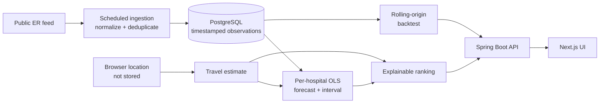

# CareRoute

CareRoute is an explainable ML decision-support application for comparing emergency departments using predicted wait-at-arrival time, estimated travel time, and data freshness.

> **Safety:** CareRoute does not diagnose symptoms or replace emergency services. If someone may be experiencing a medical emergency, call 911 or go to the nearest emergency department. ERs triage by medical severity, not arrival order.

## What makes it different

CareRoute does more than display a wait-time table. It continuously ingests public ER wait data, stores timestamped observations, and ranks options with an explainable score.

```text
score = predicted wait-at-arrival minutes + travel minutes + stale-data penalty
```

## Where ML/AI is used

CareRoute uses an **explainable per-hospital linear-regression model**. For each hospital, the backend loads up to 20 recent wait-time observations, fits wait minutes against observation time, and projects the wait forward by the visitor's estimated travel time. Predictions are bounded to avoid unstable extrapolation when the history is sparse or volatile. With fewer than three observations, the system explicitly falls back to the current reported wait.

The model name, training-window sample count, current wait, predicted wait, travel estimate, prediction interval, and final score are returned by the API and shown in the interface. This makes every recommendation traceable from source observation through forecast to ranking.

## Engineering overview

The application separates ingestion, persistence, forecasting, ranking, and presentation. Flyway migrations preserve observation identity, and the evaluator compares a transparent regression baseline against latest-wait and moving-average forecasts without using future observations.

[Forecasting design and limitations](docs/forecasting.md) · [Reproduce evaluation](docs/evaluation.md) · [CI](../../actions)

## Quick start

Requires Java 17, Maven 3.9+, and Node.js 22. In separate terminals:

```bash
cd backend
mvn spring-boot:run
```

```bash
cd frontend
npm ci
npm run dev
```

Open http://localhost:3000. Local defaults use an ephemeral H2 database; history resets when the backend exits. A public data feed is required for live observations. See configuration below for durable PostgreSQL storage.

## Verify

```bash
cd backend
mvn verify
```

Unit tests run without external services. To also run PostgreSQL migration and repeated-ingestion integration tests, set `TEST_DATABASE_URL`, `TEST_DATABASE_USERNAME`, and `TEST_DATABASE_PASSWORD` to a **disposable test database**. CI supplies PostgreSQL 17 and runs these tests on every change.

## Stack

- **Frontend:** Next.js 16 + TypeScript
- **Backend:** Java 17 + Spring Boot 4.1
- **Database:** Neon PostgreSQL for durable production history; H2 fallback for local development
- **Migrations:** Flyway
- **Persistence:** Spring Data JPA
- **Live data:** adapter-based ingestion; initial source is ER Compass' public current-wait endpoint
- **CI:** GitHub Actions
- **Frontend hosting:** Render Static Site
- **Backend hosting:** Render-compatible container

## Data flow



The backend currently polls Ontario data every 10 minutes and persists Toronto observations. The adapter boundary is intentional: direct hospital-specific sources can be added without changing the persistence or recommendation layers.

## Repository structure

```text
CareRoute/
├── frontend/
├── backend/
│   └── src/main/resources/db/migration/
├── .github/workflows/
└── README.md
```

## Backend configuration

CareRoute runs with an in-memory H2 demo database when no database variables are set, so preview deployments can start immediately. For durable history, use a managed PostgreSQL provider such as Neon and keep credentials in deployment secrets.

```text
DATABASE_URL=jdbc:postgresql://.../neondb?sslmode=require
DATABASE_USERNAME=...
DATABASE_PASSWORD=...
FLYWAY_ENABLED=true
DB_DDL_AUTO=validate
CAREROUTE_INGESTION_CITY=Toronto
CAREROUTE_INGESTION_INTERVAL_MS=600000
CAREROUTE_ALLOWED_ORIGINS=https://your-vercel-domain.vercel.app
```

Run locally:

```bash
cd backend
mvn spring-boot:run
```

API:

```text
GET /api/recommendations
GET /api/recommendations?lat=43.6532&lng=-79.3832
GET /api/model/card
GET /api/model/metrics
GET /actuator/health
```

The frontend requests browser geolocation on load and passes latitude/longitude to the API. The MVP estimates travel time using straight-line distance plus a conservative city-speed assumption. Location is used for the request and is not stored. A routing provider is a later milestone.

## Frontend

```bash
cd frontend
npm ci
npm run dev
```

For a deployed backend:

```text
NEXT_PUBLIC_API_BASE_URL=https://your-api-host.example.com
```

## Implemented

- Java/Spring Boot REST backend
- explainable linear-regression wait forecasting from recent observations
- residual-based prediction intervals
- rolling-origin backtesting against latest-wait and moving-average baselines
- live model-card and evaluation endpoints
- predicted wait-at-arrival + travel + freshness scoring
- browser geolocation with a privacy-preserving no-location fallback
- scheduled live wait-time ingestion
- resilient JSON normalization for external feed fields
- Toronto filtering
- PostgreSQL schema
- Flyway migrations
- JPA persistence and latest-observation queries
- historical wait-time snapshots
- observation deduplication and database uniqueness constraint
- responsive Next.js dashboard
- health endpoint and CI
