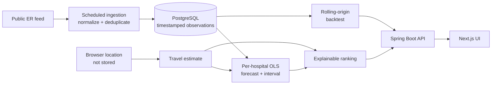

# CareRoute

CareRoute is an explainable ML decision-support application for comparing emergency departments using predicted wait-at-arrival time, estimated travel time, and data freshness.

> **Safety:** CareRoute does not diagnose symptoms or replace emergency services. If someone may be experiencing a medical emergency, call 911 or go to the nearest emergency department. ERs triage by medical severity, not arrival order.

## What makes it different

CareRoute does more than display a wait-time table. It continuously ingests public ER wait data, stores timestamped observations, and ranks options with an explainable score.

```text
score = predicted wait-at-arrival minutes + travel minutes + stale-data penalty
```

## Where ML/AI is used

CareRoute uses an **explainable per-hospital linear-regression model**. For each hospital, the backend loads up to 20 recent wait-time observations, fits wait minutes against observation time, and projects the wait forward by the visitor's estimated travel time. Predictions are bounded to avoid unstable extrapolation when the history is sparse or volatile. With fewer than three observations, the system explicitly falls back to the current reported wait.

The model name, training-window sample count, current wait, predicted wait, travel estimate, prediction interval, and final score are returned by the API and shown in the interface. This makes every recommendation traceable from source observation through forecast to ranking.

## The math

The forecasting problem is a one-feature supervised regression problem fit independently for each hospital. For observation `i`:

- `x_i` is the number of minutes since the oldest observation in the window.
- `y_i` is the reported emergency-department wait in minutes.
- The target is the expected wait at the user's estimated arrival time.

Ordinary least squares chooses the line that minimizes the sum of squared residuals:

```text
minimize  Σ(y_i - (β₀ + β₁x_i))²
  β₀,β₁   i
```

The implementation computes the slope and intercept in closed form:

```text
β₁ = Σ(x_i - x̄)(y_i - ȳ) / Σ(x_i - x̄)²
β₀ = ȳ - β₁x̄
```

If the latest observation is at `x_latest` and travel takes `t_travel` minutes, the arrival-time prediction is:

```text
ŷ_arrival = β₀ + β₁(x_latest + t_travel)
```

The recommendation objective is then:

```text
score(h) = ŷ_arrival(h) + t_travel(h) + 0.20 × min(data_age_minutes(h), 120)
```

Lower is better. The freshness term adds up to 24 penalty minutes, making stale observations less competitive without silently discarding them.

### Why this model?

Linear regression is an intentional baseline: it is fast, deterministic, works with small per-hospital windows, and exposes a slope that can be inspected. A more complex model is not automatically a better product decision—especially before enough durable history exists to evaluate it. This baseline creates a measurable benchmark for future time-series models.

Runtime per hospital is `O(n)` time over at most 20 observations and `O(1)` additional model space. Training happens during the recommendation request; there is no serialized model artifact in this version.

### Guardrails and failure modes

- Fewer than three samples → use the current reported wait and return `CURRENT_WAIT_FALLBACK`.
- Zero variance in observation timestamps → fall back instead of dividing by zero.
- Final predictions are limited to the valid `[0, 720]` minute range.
- Extrapolation is limited to `current wait ± 60 minutes` to reduce sensitivity to short-lived spikes.
- The model is per hospital, so one hospital's scale or trend cannot dominate another's fit.
- Geolocation affects the forecast horizon and travel component; coordinates are not persisted.

The current model does **not** capture hour-of-day, day-of-week, triage acuity, queue length, staffing, traffic routes, calibrated clinical uncertainty, or causal effects. Its residual-based interval communicates model spread but is not a clinically validated confidence interval. This remains an interpretable prototype forecast—not a clinical predictor.

## Evaluation

CareRoute implements a rolling-origin backtest. For each timestamp, the evaluator trains only on earlier observations and predicts the next reported wait, preventing future-data leakage. It compares the regression model with the latest reported wait and a three-observation moving average.

Reported measurements:

| Metric / check | Why it matters |
| --- | --- |
| MAE in minutes | Easy-to-interpret average forecast error |
| RMSE in minutes | Penalizes occasional large misses |
| Median absolute error | More robust to extreme wait-time spikes |
| Baseline comparison | Tests whether regression beats “use the latest wait” |
| Error by horizon | Shows degradation for longer travel times |
| Error by hospital and time of day | Detects uneven performance and temporal bias |
| Prediction-interval coverage | Quantifies whether displayed uncertainty is calibrated |

The live `/api/model/metrics` endpoint reports stored observations, out-of-sample prediction count, MAE, RMSE, median absolute error, baseline errors, and interval coverage. The UI remains in `COLLECTING_HISTORY` until at least 10 out-of-sample predictions exist. No accuracy number is claimed before that threshold, and the current free demo's in-memory database can reset on deployment.

## Model card

| Field | Value |
| --- | --- |
| Model | `LINEAR_REGRESSION_V1` |
| Type | Per-hospital ordinary least squares regression |
| Intended use | Estimate wait at arrival to support an explainable ED ranking |
| Inputs | Recent waits, timestamps, and travel-time forecast horizon |
| Output | Bounded wait prediction with a residual-based 95% interval |
| Not intended for | Diagnosis, triage, or clinical decision-making |
| Minimum history | Three observations; otherwise use the current-wait fallback |
| Evaluation | Leakage-safe rolling-origin backtest against two baselines |
| Known gaps | No route traffic, staffing, acuity, calibrated clinical uncertainty, or external validation |

The same machine-readable card is available from `GET /api/model/card`.

## ML engineering decisions demonstrated

- Turns a user decision into an explicit, inspectable optimization objective.
- Separates ingestion, persistence, forecasting, ranking, and presentation layers.
- Handles sparse data and degenerate features with named fallbacks.
- Prevents unbounded extrapolation at an operational decision boundary.
- Returns model metadata with every prediction for observability and UI transparency.
- Includes a deterministic unit test where waits `40 → 50 → 60` predict `70` ten minutes later.
- Documents leakage-safe evaluation before claiming model quality.

## Stack

- **Frontend:** Next.js 16 + TypeScript
- **Backend:** Java 17 + Spring Boot 4.1
- **Database:** Neon PostgreSQL for durable production history; H2 fallback for local development
- **Migrations:** Flyway
- **Persistence:** Spring Data JPA
- **Live data:** adapter-based ingestion; initial source is ER Compass' public current-wait endpoint
- **CI:** GitHub Actions
- **Frontend hosting:** Render Static Site
- **Backend hosting:** Render-compatible container

## Data flow



The backend currently polls Ontario data every 10 minutes and persists Toronto observations. The adapter boundary is intentional: direct hospital-specific sources can be added without changing the persistence or recommendation layers.

## Repository structure

```text
CareRoute/
├── frontend/
├── backend/
│   └── src/main/resources/db/migration/
├── .github/workflows/
└── README.md
```

## Backend configuration

CareRoute runs with an in-memory H2 demo database when no database variables are set, so preview deployments can start immediately. For durable history, use a managed PostgreSQL provider such as Neon and keep credentials in deployment secrets.

```text
DATABASE_URL=jdbc:postgresql://.../neondb?sslmode=require
DATABASE_USERNAME=...
DATABASE_PASSWORD=...
FLYWAY_ENABLED=true
DB_DDL_AUTO=validate
CAREROUTE_INGESTION_CITY=Toronto
CAREROUTE_INGESTION_INTERVAL_MS=600000
CAREROUTE_ALLOWED_ORIGINS=https://your-vercel-domain.vercel.app
```

Run locally:

```bash
cd backend
mvn spring-boot:run
```

API:

```text
GET /api/recommendations
GET /api/recommendations?lat=43.6532&lng=-79.3832
GET /api/model/card
GET /api/model/metrics
GET /actuator/health
```

The frontend requests browser geolocation on load and passes latitude/longitude to the API. The MVP estimates travel time using straight-line distance plus a conservative city-speed assumption. Location is used for the request and is not stored. A routing provider is a later milestone.

## Frontend

```bash
cd frontend
npm install
npm run dev
```

For a deployed backend:

```text
NEXT_PUBLIC_API_BASE_URL=https://your-api-host.example.com
```

## Implemented

- Java/Spring Boot REST backend
- explainable linear-regression wait forecasting from recent observations
- residual-based prediction intervals
- rolling-origin backtesting against latest-wait and moving-average baselines
- live model-card and evaluation endpoints
- predicted wait-at-arrival + travel + freshness scoring
- browser geolocation with a privacy-preserving no-location fallback
- scheduled live wait-time ingestion
- resilient JSON normalization for external feed fields
- Toronto filtering
- PostgreSQL schema
- Flyway migrations
- JPA persistence and latest-observation queries
- historical wait-time snapshots
- observation deduplication and database uniqueness constraint
- responsive Next.js dashboard
- health endpoint and CI
