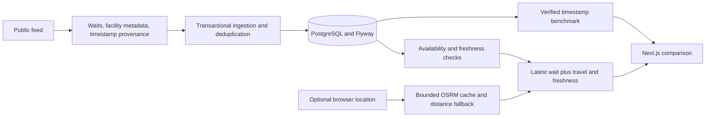

# CareRoute architecture

## Ingestion and eligibility

Network ingestion has explicit connection/read timeouts and occurs outside the database transaction. Facility updates and observations commit together. Success is recorded only after transaction completion; network and persistence failures update ingestion health without returning exception URLs or credentials.

A successful feed snapshot marks missing facilities as currently unavailable. Rows with missing waits are retained as facilities but do not create observations. Emergency type, pediatric designation and opening status determine eligibility; unknown metadata fails closed. Availability, last feed presence and observation freshness are checked before routing. V3 initially marks legacy facilities unavailable until refreshed.

The feed's verified observation timestamps are stored with source `ER_COMPASS_OBSERVED`. If only a parseable `fetched_at` is available, the source is `ER_COMPASS_FETCH_TIME`; the UI labels that distinction. Missing/invalid timestamps cannot become fresh simply because the parser ran now. New ingestion does not import untimestamped sparkline history. Existing backfill and legacy records remain stored but excluded from comparison and benchmark queries.

## Comparison

Only open adult emergency facilities with currently available waits and data no more than 30 minutes old receive scores. Unavailable facilities are returned after available facilities, with null scores and explicit reasons. Without user location, travel is null and explicitly excluded. With user location, missing destination coordinates yield unknown travel, making the facility unavailable for personalized comparison.

The production model is the latest-wait baseline. Linear regression is an offline challenger and accepts an explicit arrival timestamp to account for observation age. Heuristic residual ranges have no promised coverage level.

The frontend refreshes every minute while visible and on focus. Requests are aborted when superseded or unmounted, and have a 30-second deadline. Failed refreshes remove prior results. Location is opt-in, held in memory, and can be disabled; late geolocation callbacks cannot re-enable a cancelled request.

## Routing and privacy

Routing uses one-second connect and three-second read timeouts. A bounded cache retains at most 1,000 rounded coordinate keys. Road results expire after five minutes; distance fallbacks after 30 seconds. Scheduled cleanup runs every minute even without incoming requests. Network requests do not hold the cache lock. Separate scheduler capacity prevents feed I/O from occupying the only cleanup thread.

Coordinates are not persisted to the application database. OSRM receives coordinates, and infrastructure providers may process request logs. The frontend discloses those boundaries. Routing logs contain exception class names, not exception messages that could include URLs. Tomcat access logs are disabled by default.

## Evaluation and limitations

See [evaluation.md](evaluation.md) for the primary timestamp and reporting rules. The ten-prediction threshold only controls display. Model promotion remains a deliberate engineering decision requiring representative validation and ranking-level evaluation. The application has no clinical suitability model, staffing inputs, live traffic or assurance of complete facility coverage.
