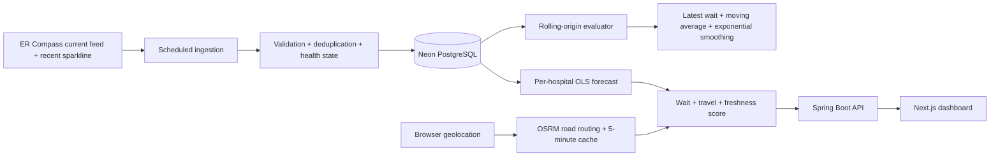

# CareRoute architecture

## System overview

## Data lifecycle

1. The ingestion job polls the normalized public feed every ten minutes.
2. On its first successful observation for a hospital, it imports the feed's real 12-point recent-history sparkline. The feed does not expose timestamps for those points, so CareRoute reconstructs 15-minute timestamps ending at `fetched_at` and labels every row `ER_COMPASS_SPARK_BACKFILL`.
3. A database uniqueness constraint and application-level check make ingestion idempotent.
4. Flyway owns the production schema. Hibernate validates it but does not mutate it.
5. Neon retains observations across Render deployments.

## Online request path

1. The browser sends coordinates only with the recommendation request.
2. The routing adapter requests road distance and duration from OSRM. Results are cached for five minutes; a deterministic Haversine estimate keeps the API available during routing outages.
3. For each hospital, the forecasting service fits OLS over its 20 newest observations and predicts at the route-duration horizon.
4. The ranking service returns the complete score breakdown: forecast wait, travel duration, and freshness penalty.

## Model evaluation

Every target is evaluated using only earlier observations. OLS is compared on identical targets with the latest observed wait, a three-observation moving average, and simple exponential smoothing with `alpha = 0.5`. The API reports MAE, RMSE, median absolute error, and interval coverage. Metrics remain provisional until ten out-of-sample predictions exist.

## Privacy and security

- User coordinates are not persisted.
- Database credentials live in Render secrets.
- Production schema changes are versioned as Flyway migrations.
